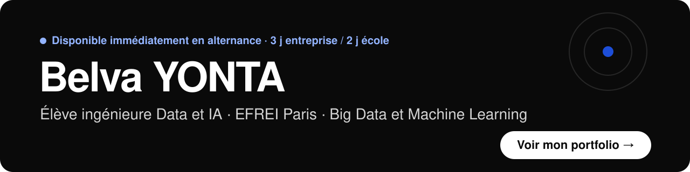

### Bonjour, je suis Belva

Élève ingénieure **Data et IA** à l'EFREI Paris (Big Data et Machine Learning).
Je cherche une **alternance disponible immédiatement**, au rythme de 3 jours en entreprise et 2 jours à l'école, jusqu'à l'été 2028.

**👉 [Voir mon portfolio : kysyb2006.github.io](https://kysyb2006.github.io/)**

### Projets phares

| Projet | Ce qu'il montre | Liens |
|---|---|---|
| **Qualité du vin**, classification par Machine Learning | Random Forest rééquilibré : 145 bons vins retrouvés sur 252 (F1 de 0,54 en test). Streamlit, Docker, CI GitHub Actions | [Démo](https://winequalityclassificator-efrei.streamlit.app/) · [Code](https://github.com/KYSyB2006/WineQualityClassificator) |
| **Recherche sémantique d'offres d'alternance** | Embeddings et pgvector (moins de 7 ms sur 4 000 offres), deux agents, plus de 500 tests | [Code](https://github.com/KYSyB2006/alternance-finder) |
| **MediConnect**, de la base au tableau de bord | MySQL, MongoDB, Power BI : un écart offre / demande révélé sur les spécialités médicales | [Étude de cas](https://kysyb2006.github.io/mediconnect-portfolio/) |
| **Agent de jeu Teeko** | Règles en Prolog et heuristique d'évaluation pour un moteur Alpha-Beta | [Étude de cas](https://kysyb2006.github.io/teeko-portfolio/) |

### Outils

Python · pandas · scikit-learn · SQL (PostgreSQL, MySQL) · MongoDB · Power BI · DAX · FastAPI · Streamlit · Docker · GitHub Actions

### Me contacter

[yontabelva@gmail.com](mailto:yontabelva@gmail.com) · [LinkedIn](https://www.linkedin.com/in/samyra-yonta)
